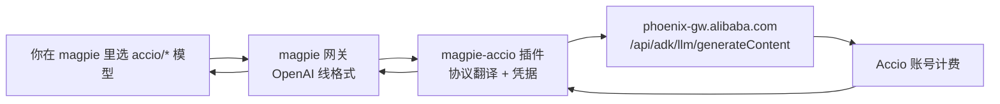

# magpie-accio

把 **Accio（阿里 Accio Work，中国版）** 的模型接进 **magpie**：**网页登录一次，不需要 Accio 桌面客户端**。



对照参考项目 [tidys/dsh-connect-accio](https://github.com/tidys/dsh-connect-accio)：那个读的是
**本机已登录的 Accio 客户端**（DPAPI 解 `credentials.enc` + 客户端自带 `security_guard.node` 签名），
只能装在 Windows、必须先开客户端。**本插件反过来**：不碰本机客户端任何文件，用 Accio 自己的
**网页 OAuth（PKCE）** 登录，凭据存在 magpie 的插件登录态里。

> 非官方插件。计费走你自己的 Accio 账号。**只做中国版**（`www.accio-ai.com`）。

---

## 安装

```sh
magpie plugin add "<本目录的绝对路径>"
# 装完重启 magpie（供应商列表在启动时挂上）
```

装好后：**magpie → Library / 供应商**，会看到 **Accio（阿里）** 一条：

1. 点 **登录 Accio（阿里）**。
2. magpie 会用**系统默认浏览器**打开 Accio 登录页（插件只负责本地回调服务，不自己起浏览器）。
3. 正常登录（手机号 / 邮箱 / 扫码皆可）。回调页出现「授权已收到」即完成；
   magpie 侧弹「Accio 登录成功（账号名）」。
4. 模型选择器里出现 `accio/…`，**名字后面就是倍率**（`Qwen 3.8 Flash · x0.03`），
   倍率 = 每 token 花掉的积分倍数，挑模型时直接看这个数。

给 **DeepSeek Harness** 用：在 magpie 的 Agents 页把 DSH 指向 magpie 网关，模型选
`accio/<模型>` 即可，DSH 侧不装任何东西。

### 账号卡片

登录后卡片显示三类积分的占用与剩余、每日额度刷新倒计时（只读，不消耗积分）。
免费账号的「每月积分」桶是 `total:0 / remaining:0` —— 意思是这个桶没开通，插件**不会**把它
画成「已用 100%」，只显示真实存在的桶（每日 / 推荐）。

---

## 模型目录怎么筛

目录来自 `POST /api/llm/config/v2`（token 在 body）。逐条筛选：

| 规则 | 说明 |
| --- | --- |
| `visible === true` | 服务端不下发的不要 |
| **`locked` 为空** | 套餐不够、用不了的（客户端里显示「已锁定」）**不拉取**，免得选了必然失败 |
| 有 `modelCode` | 空 id 会让整个目录不可用 |
| 名字带倍率 | `effectiveMultiple` → `名字 · x0.03`；没有倍率的条目就不加后缀 |

所以选择器里**只有真的能用、且标了倍率**的模型。中国区账号实测 16 个（Qwen 3.8 系、GLM 5.x、
DeepSeek V4 系、Kimi K2.6、MiniMax M3、Standard / Professional / Ultimate）。

> 中国区的目录里没有 GPT —— 不是插件过滤，是账号的 `routeRegion: CN` 决定了服务端只下发这一套
> （46 条原始条目里 GPT 只有 3 条**图像**模型，且 `visible:false`）。国际区账号才有 GPT/Grok，
> 本插件**不提供国际版入口**。

---

## 可选：把 Accio 直接反代成一个 OpenAI 端点

不想经过 magpie 网关（curl / Chatbox / 其它只认 `/v1` 的工具）时，给插件一个选项：

```json
{ "relay": { "port": 47821, "token": "" } }
```

| 字段 | 说明 |
| --- | --- |
| `relay.port` | 监听端口；不写 = 不开反代 |
| `relay.host` | 默认 `127.0.0.1`；只绑回环，别改成 `0.0.0.0` |
| `relay.token` | 非空时要求 `Authorization: Bearer <token>`；留空只允许本机回环访问 |

```sh
curl http://127.0.0.1:47821/v1/models

curl http://127.0.0.1:47821/v1/chat/completions \
  -H 'content-type: application/json' \
  -d '{"model":"deepseek-v4-pro","messages":[{"role":"user","content":"你好"}],"stream":true}'
```

### 其它选项

| 选项 | 默认 | 说明 |
| --- | --- | --- |
| `proxy` | 跟随宿主 | 不写就用 magpie 注入的 `HTTPS_PROXY/HTTP_PROXY/ALL_PROXY`；写了用它（`fetch` 的 `proxy`） |

---

## 文件结构

```
index.mjs        # 插件入口：magpie/OpenCode 的 config / auth / provider 钩子
src/accio.mjs    # 协议层：PKCE 登录、目录、OpenAI⇄Gemini 信封、SSE 翻译、额度
src/icon.mjs     # 图标：随包 PNG → data:image/png URI（magpie 不下载外链）
src/relay.mjs    # 可选：127.0.0.1 上的 OpenAI 兼容反代服务
icons/           # accio-48/128/256.png
publish/         # 推 GitHub / 发 npm / 提 registry PR 的脚本（见 publish/PUBLISH.md）
test/run.mjs     # 离线自测（不联网、不碰 magpie）
```

### 图标

magpie 的 `iconOf()` 只收 `https://` 或 `data:image/` 开头的字符串，而且**不会替你下载**。
Accio 官网的 `favicon.ico` 实测返回的是 `text/html`（30KB 的 SPA 页面），渲染不出来 ——
所以图标改成**官网那个 mark**：

| 文件 | 来源 |
| --- | --- |
| `icons/accio-official.svg` | 站点 `<link rel="icon">`：`s.alicdn.com/@img/imgextra/i4/O1CN01L3EOoU1IfPQXGpYhJ_!!6000000000920-55-tps-24-24.svg`（1372B，A 字 + 青绿渐变） |
| `icons/accio-48/128/256.png` | 用 headless Edge 把上面的 SVG 渲成 PNG，白底圆角（深色界面里也看得见） |

`auth.icon` 在运行时把 `icons/accio-128.png` 读成 `data:image/png;base64,…`（约 5KB），
离线可用、不依赖外链，也不依赖 registry 是否收录。

## 发布 / 上架到 magpie 插件市场

见 [publish/PUBLISH.md](publish/PUBLISH.md)：两个脚本（都不需要 git）
—— `publish/github-upload.mjs` 推 GitHub、`publish/open-registry-pr.mjs` 给
`magpie-community/plugins` 的 `registry.json` 提 PR（上架后 magpie 里能搜到）。

自测：

```sh
node test/run.mjs
# 或 magpie 自带的 bun：
"C:\Users\<你>\.cache\magpie\bun\1.4.4\magpie-bun.exe" test/run.mjs
```

覆盖：信封解析、秒→毫秒、目录归一（含 **locked 不拉取**、倍率后缀）、slug↔modelCode、
工具结果配对与图片后置、请求体形状（token 在 body / `system_instruction` 是字符串 /
工具 schema 不被 snake 化）、SSE→OpenAI chunk（思维链、分片工具调用、用量）、401 硬续期、
「HTTP 200 + HTML = 风控页」判据、反代的 `/v1/models`、`/v1/chat/completions` 与 token 校验、
宿主登录态的两道门（`type:'success'` + `refresh`）。

---

## 协议要点（踩过的坑，都在代码注释里）

1. **token 必须放请求体 `body.token`**：放 `Authorization` 头会稳定拿到流内 402。
2. **上行 `model` 是 `modelCode`**（`1Drift-…` 这种不可读串），展示名只是对外 id。
   发展示名 → 请求打空（模型不回复）。插件内部维护 slug↔code 映射，目录刷新时重建。
3. **工具结果**必须 `role:user + functionResponse`，并且**紧挨着**上一批 `functionCall`；
   中间插任何消息都会断开配对。工具结果里内嵌的图片会挪到该批之后单独一条 user 消息。
4. **`HTTP 200` + `text/html`** 是阿里风控拦截页，不是回复 —— 必须校验 content-type。
5. **`refresh_token` 一次性轮换**：并发续期 = 一个成功、其余 `invalid_grant`，还会把账号标死。
   插件对同一 `refresh_token` 做了单飞，失败按网络抖动降级复用旧凭据。
6. **403 需要分流**：`403 + HTML` 是风控，**不能**续期；`401/403 + JSON` 才续期重发一次。

## 和 magpie 宿主的三条契约

| 坑 | 宿主的实际规则 | 做法 |
| --- | --- | --- |
| 登录弹「the sign-in failed」（无细节） | `if (!r \|\| r.type !== "success") return failed(r)`，而 `failed()` 取不到 `error` 就只剩前缀 | `callback()` 返回 `{type:'success', access, refresh, expires, …}` |
| 登录弹「gave nothing to keep」 | `keptAs()` 只认 `refresh` / `key` / 非空 `access` | 同上，必须带 `refresh` 或 `access` |
| 账号到点不续期 | `renewAt()` 只在 `stored.type === 'oauth'` 时生效 | 自己写槽用 `{type:'oauth', …}`；旧槽在 `models()` / `loader()` 里就地升级 |

## 已知限制

- **非官方**：Accio 未提供公开的第三方接入文档，接口按 2026-11 客户端实测口径实现。
- **只做中国版**：登录页固定 `www.accio-ai.com`，国际区账号/模型不提供入口。
- **计费在 Accio 侧**：每次对话都消耗账号积分；只有拉目录、查额度、续期不消耗。
- **思考关不掉**：上游没有受控字段能关模型的 reasoning；档位只做展示。
- **图片只收 base64 data URL**：远程图片链接会被明确拒绝，请先下载成 data URL。

## 排障

| 症状 | 先看这里 |
| --- | --- |
| 模型选择器是空的 | 插件没加载（`magpie plugin list`）或未登录；日志里找 `magpie-accio:` |
| 聊天立刻 401 | 没登录 / 登录已失效：重新点登录 |
| 卡片没有「每月积分」 | 正常：免费账号没有这个桶，只有每日 + 推荐 |
| 目录里只有十几个模型 | 正常：`visible` 且非 `locked` 的中国区模型就这些 |
| 回复永远是空的 | 多半是风控：本插件会明确报「上游没有返回事件流」 |
| 登录页提示「请升级客户端」 | 授权 URL 缺 `code_challenge`（本插件已带；改代码时别删） |
| 反代端口起不来 | 端口被占；换 `relay.port`，或用日志里的错误原文 |

## 许可

MIT
