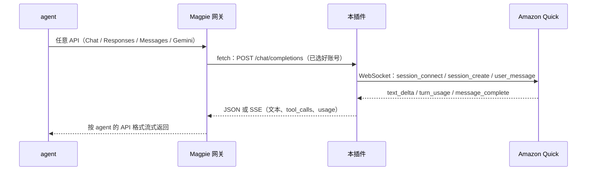

<p align="center"></p>

# magpie-AWS-Quick-bridge

<p align="center">
  作者：<a href="https://github.com/DaBinBinah">DaBinBinah</a> ·
  <a href="https://x.com/yedabinbinah">X / Twitter @yedabinbinah</a> ·
  <a href="https://www.npmjs.com/package/magpie-aws-quick-bridge">npm</a>
</p>

我做的一个 [Magpie](https://usemagpie.ai) 供应商插件，把 **Amazon Quick（QuickWork）** 接入 Magpie：在 Magpie 里登录 Amazon Quick 账号后，Claude Code、Codex、OpenCode 等所有 agent 都能以 `aws-quick/<model>` 使用它。

使用中遇到问题或有建议，欢迎提 [issue](https://github.com/DaBinBinah/magpie-AWS-Quick-bridge/issues)，或者在 [X 上找我](https://x.com/yedabinbinah)。

> 非官方项目，与 Amazon / AWS 无关联。请仅在你拥有或获得明确授权的账号上使用，并遵守相关服务条款。

## 功能

- 浏览器登录 Amazon Quick：个人账号（social）与企业账号（IAM Identity Center / SSO），PKCE
- Magpie 在另一台电脑（服务器、Docker）上时，把浏览器最后停下的地址粘贴回 Magpie 即可完成登录
- 多账号、故障切换、并发上限由 Magpie 负责；token 到期前 10 分钟由 Magpie 调用插件自动续期
- agent 用哪种 API 都可以：Magpie 网关先转成 chat completions 再交给插件（Chat Completions、Responses、Anthropic Messages 已在网关上验证）
- 流式与非流式回复，返回上游 `turn_usage` 的 token 用量和缓存命中
- 客户端工具调用：`tools` 通过 `<client_tool_call>` 文本协议桥接，返回标准 `tool_calls`；带工具的流式回复也是边生成边输出，只有工具调用标记本身会被拦下
- `system` / `developer` 消息走 Amazon Quick 原生的 `system_prompt`，并附加覆盖声明，让模型忽略服务端追加的提示词
- 默认每轮结束后删除上游会话，不污染 Amazon Quick 自己的聊天列表
- 没有运行时依赖，也没有安装脚本

## 模型

| Magpie 里的模型 | Amazon Quick 的 agent mode |
|---|---|
| `aws-quick/smart` | smart |
| `aws-quick/fast` | fast |
| `aws-quick/balanced` | balanced |
| `aws-quick/auto` | auto |

Amazon Quick 没有模型列表接口，这四个是它的 agent mode。上下文长度（200k）和最大输出（32k）是插件里填的估计值，Amazon Quick 没有公布；推理档位 low / medium / high 对应上游的 `thinking_effort`。

## 安装

```sh
# 从 npm
magpie plugin add magpie-aws-quick-bridge

# 从 GitHub
magpie plugin add github:DaBinBinah/magpie-AWS-Quick-bridge

# 或者从本地文件夹，就地加载，不安装任何东西
magpie plugin add /path/to/magpie-AWS-Quick-bridge
```

在应用里：**插件 → 添加插件**，填上面任一写法。

## 登录

```sh
magpie plugin login aws-quick
```

在应用里则是在 **Amazon Quick** 那一行点登录。步骤：

1. 选择账号类型：个人账号，或企业账号（再填组织所在的 AWS 区域，留空为 `us-east-1`）。
2. Magpie 打开浏览器，在 Amazon Quick 的页面完成登录；浏览器会回到本机的回调端口（默认 `18080`，被占用时个人账号自动换用 `18081`–`18083` 或任意空闲端口）。
3. 接着自动跳到 AWS 的授权页，同意后看到 “Login complete” 即完成。

需要多个账号时重复登录即可；同一邮箱再次登录会替换原来的那个账号。

### Magpie 在另一台电脑上

浏览器访问不到服务器的 `localhost` 时：

1. 在自己的浏览器里打开登录说明中给出的 `https://quick.aws.com/sn?qwSurface=…` 地址并登录。
2. 浏览器会停在一个打不开的 `http://localhost:18080/callback?nonce=…` 页面。把地址栏里的**完整地址**粘贴回 Magpie（终端里直接粘贴后回车；应用里填进登录窗口的 Callback URL）。
3. Magpie 给出下一步要打开的 AWS 授权地址（终端里是一行 `Amazon Quick sign-in, next page to open: …`）。打开它并同意。
4. 浏览器停在 `http://127.0.0.1:18080/?code=…`，再把这个完整地址粘贴回 Magpie，登录完成。

也可以用 SSH 端口转发让回调直接可达：`ssh -L 18080:127.0.0.1:18080 <服务器>`。

### 登录信息存在哪里

存在 Magpie 配置目录的 `plugin-auth.json`（权限 600，`~/.config/magpie/` 或 `$XDG_CONFIG_HOME/magpie/`），包括 access token、refresh token、id token、OAuth client 的 id 和 secret，以及邮箱、租户地址等账号信息。登录密码只在 Amazon 的页面里输入，插件接触不到。`magpie plugin logout aws-quick` 删除它。

## 选项

```sh
magpie plugin options magpie-AWS-Quick-bridge '{"thinking_effort": "medium", "timezone": "Asia/Shanghai", "locale": "zh-CN"}'
```

| 选项 | 默认 | 说明 |
|---|---|---|
| `thinking_effort` | 空 | 请求没有指定推理档位时使用：`off`、`low`、`medium`、`high` |
| `default_model` | `smart` | 收到未知模型名时使用的 agent mode |
| `timezone` / `locale` | `UTC` / `en-US` | 发给上游的时区与语言 |
| `request_timeout` | `5m` | 单次上游请求超时（`30s`、`5m`、`1h`，或秒数） |
| `keep_sessions` | `false` | 保留上游会话，不在一轮结束后删除（也可在供应商编辑页的插件选项里开关） |
| `app_version` | `1.2.4660` | 上游握手使用的 appVersion |
| `surface` | `QUICK_WORK_DESKTOP_WINDOWS` | 上游握手使用的 surfaceType |
| `outpost_id` / `working_session_id` | 空 | 上游握手可选字段 |
| `callback_port` | `18080` | 本机 OAuth 回调端口；`0` 为任意空闲端口 |
| `login_timeout` | `30m` | 等待浏览器完成登录的时间 |
| `build_stage` | `prod` | `prod`、`beta`、`integ`、`dev` |
| `proxy` | 空 | 聊天 WebSocket 使用的代理地址（见下面的限制） |
| `oidc_base` / `discovery_url` / `data_plane_url` | 空 | 覆盖上游地址，仅用于测试（模拟上游） |

改动选项会重启插件宿主，从下一个请求起生效。

## 工作方式



- 每个请求打开一条到 Amazon Quick 的 WebSocket，把整段对话转成一条 `user_message`：单条用户消息原样发送，多轮对话和工具结果按 `User:` / `Assistant tool call (...)` / `Tool result (...)` 渲染。
- 工具只在客户端执行：插件把模型输出的 `<client_tool_call>{"name":…,"arguments":…}</client_tool_call>` 转成 `tool_calls`，下一轮再把工具结果作为文本带回去。`tool_choice: "none"` 关闭桥接，指定函数时只接受该函数。
- 出错时尽量用 Magpie 能处理的状态回答：上游拒绝登录回 401（账号被标记为需要重新登录），限流回 429，超时回 504，其他上游错误回 502，Magpie 据此切换到下一个账号或模型。回复开始之后的错误只能写进流里。

代码结构：

```
index.mjs            插件入口：config / auth（登录、refresh、loader）钩子
plugin/oauth.mjs     发现、IDC client 注册、PKCE、换 token、refresh、user-info
plugin/login.mjs     本机回调端口上的浏览器登录
plugin/upstream.mjs  一轮对话的 WebSocket 收发
plugin/wire.mjs      AIDP / Gateway 帧、AWS event-stream、CBOR
plugin/messages.mjs  OpenAI 消息 → user_message 文本与 system_prompt
plugin/toolbridge.mjs 客户端工具的文本协议与流式解析
plugin/chat.mjs      chat completions 的 JSON / SSE 回复
test/                单元测试、模拟上游、端到端测试
```

## 开发与测试

需要 [Bun](https://bun.sh)。

```sh
bun test                              # 单元测试 + 对模拟上游的端到端测试
```

在沙箱里的 Magpie 中试用，不会碰到你正在用的 Magpie、agent 和登录信息：

```sh
sb=$(mktemp -d)
m() { env HOME=$sb XDG_CONFIG_HOME=$sb/.config XDG_CACHE_HOME=$sb/.cache MAGPIE_ADDR=127.0.0.1:3499 magpie "$@"; }
m plugin add . </dev/null
m plugin --json                       # 登录方式、账号、模型、加载错误
m plugin login aws-quick              # 真实登录
m provider test aws-quick             # 发一个很小的请求
m plugin logout aws-quick
```

没有 Amazon Quick 账号时可以用仓库里的模拟上游走通整个流程（登录页、OIDC、user-info、聊天 WebSocket 都在本机）：

```sh
bun test/mock-upstream.mjs 39100      # 会打印下面要用的选项
m plugin options magpie-AWS-Quick-bridge '{"oidc_base":"http://127.0.0.1:39100","discovery_url":"http://127.0.0.1:39100/sn","data_plane_url":"http://127.0.0.1:39100"}'
m plugin login aws-quick
m provider test aws-quick
```

## 发布与上架

1. **版本**：改 `package.json` 的 `version`。
2. **npm**：`npm publish`。之后用户可以 `magpie plugin add magpie-aws-quick-bridge`，Magpie 插件页的搜索也能按 `opencode` 关键词找到它，详情页显示这份 README。
3. **GitHub 标签**：给仓库加上 `magpie-plugin` topic，几分钟后它会出现在 **插件 → 发现 → 非官方插件 · GitHub**。卡片的名字、简介和图标取自 `package.json` 的 `magpie.name`、`magpie.summary`、`magpie.icon`。发布到 npm 且 `repository` 指向本仓库时从 npm 安装，否则按仓库当前代码安装（插件加载的文件都已提交在仓库里）。
4. **推荐列表**：向 [magpie-community/plugins](https://github.com/magpie-community/plugins) 提一个 PR，在 `registry.json` 里加一项：

   ```json
   { "package": "magpie-aws-quick-bridge", "name": "Amazon Quick", "providers": ["aws-quick"],
     "icon": "https://raw.githubusercontent.com/DaBinBinah/magpie-AWS-Quick-bridge/main/assets/icon-128.png",
     "summary": { "en": "Amazon Quick (QuickWork) with browser sign-in for personal and enterprise accounts: streaming chat and client tool calls. Unofficial.",
                  "zh": "浏览器登录 Amazon Quick（QuickWork）个人或企业账号，支持流式对话与客户端工具调用。非官方。" } }
   ```

   `MAGPIE_PLUGIN_MARKET=<url>` 可以让 Magpie 改读另一份列表，用来在提 PR 前检查这一项。

`package.json` 里的 `magpie.icon` 是内嵌的 128px logo（data URI），所以从文件夹或 git 安装时也有图标；仓库公开后可以换成上面那样的 `https://` 地址。

## 限制

- **真实上游的验证范围**：我目前只对仓库里的模拟上游做过端到端验证（包括在 Magpie 里登录、粘贴回调登录和经网关请求），还没有用真实的 Amazon Quick 账号验证过。`gateway` / `social_gateway` 的 CBOR 路径属实验性。
- 只有聊天。`temperature`、`max_tokens`、`stop`、`response_format` 等采样参数不会传给上游；`n > 1` 返回 400。
- 输入只有文本：图片、音频、文件会变成 `[image]`、`[audio]`、`[file]` 占位。
- 工具桥接是文本协议，模型偶尔可能不遵守；回复以 `{`、`[` 或反引号开头时会先整段缓冲，以判断它是不是一个没带标记的工具调用。
- 没有用量接口，所以 `magpie quota` 不显示 Amazon Quick 的额度。
- 代理：按 Magpie 的文档，插件用 `fetch` 发出的请求（登录、续期）走 Magpie 给供应商或账号设置的代理。聊天用的是 WebSocket，它是否也走这个代理没有验证过；需要时用 `proxy` 选项明确指定（如 `http://127.0.0.1:7890`）。
- 以 OpenCode v1 插件的形式导出（`export default { id, server }`），只在 Magpie 里验证过，没有提供 OpenCode 2.x 的入口。
- 上游接口可能随官方客户端更新而变化；登录或聊天失败时先重新登录，必要时调整 `app_version`。

## 作者

DaBinBinah

- X / Twitter：[@yedabinbinah](https://x.com/yedabinbinah)
- GitHub：[DaBinBinah](https://github.com/DaBinBinah)

## License

[GNU General Public License v3.0](LICENSE)。

Magpie 插件部分（`index.mjs`、`plugin/`、`test/`）© 2026 DaBinBinah。登录流程、协议编解码和工具桥接移植自 [aws-quickwork-2api](https://github.com/jasonxu114514/aws-quickwork-2api)（© Jason Xu，GPL-3.0）；按 GPL-3.0 的要求保留这条来源说明，并以同一许可证发布。
